  

  ## Sobre Mí

Soy **Edwar Granados** (`@SirEdward97`), de Colombia 🇨🇴. Tecnólogo en Desarrollo Front-End y Desarrollador Full-Stack apasionado por unir ingeniería moderna con experiencias interactivas 3D en tiempo real.

- 🚀 **Construyendo ahora:** Experiencias interactivas en **Three.js / WebGL 2.0** (*Oracle Red Bull Racing RB22*, *Portafolio Galaxia 3D*) y **SIGIF**
- 🌍 **Meta:** crear productos globales de alto impacto en **Full-Stack, Web 3D e IA**
- 🤝 **Abierto a:** oportunidades remotas, colaboraciones y proyectos freelance
- 💬 ¿Tienes alguna pregunta o idea? ¡No dudes en escribirme!

  ## Lenguajes y actividad

  

  ## Contacto

  
  
  
  

