  

  ## About Me

I'm **Edwar Granados** (`@SirEdward97`), from Colombia 🇨🇴. I'm a Front-End Technologist & Full-Stack Developer passionate about combining modern software engineering with real-time 3D web experiences.

- 🚀 **Building now:** Interactive **Three.js / WebGL 2.0** showcases (*Oracle Red Bull Racing RB22*, *3D Galaxy Portfolio*) & **SIGIF**
- 🌍 **Goal:** to build high-impact **Full-Stack, 3D Web & AI** products globally
- 🤝 **Open to:** remote roles, collaborations, and freelance work
- 💬 Any questions? Feel free to reach out!

  ## Languages and activity

  

  ## Contacts

  
  
  
  

